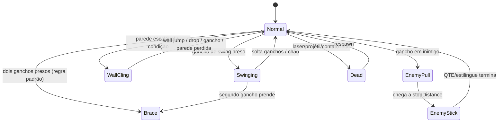
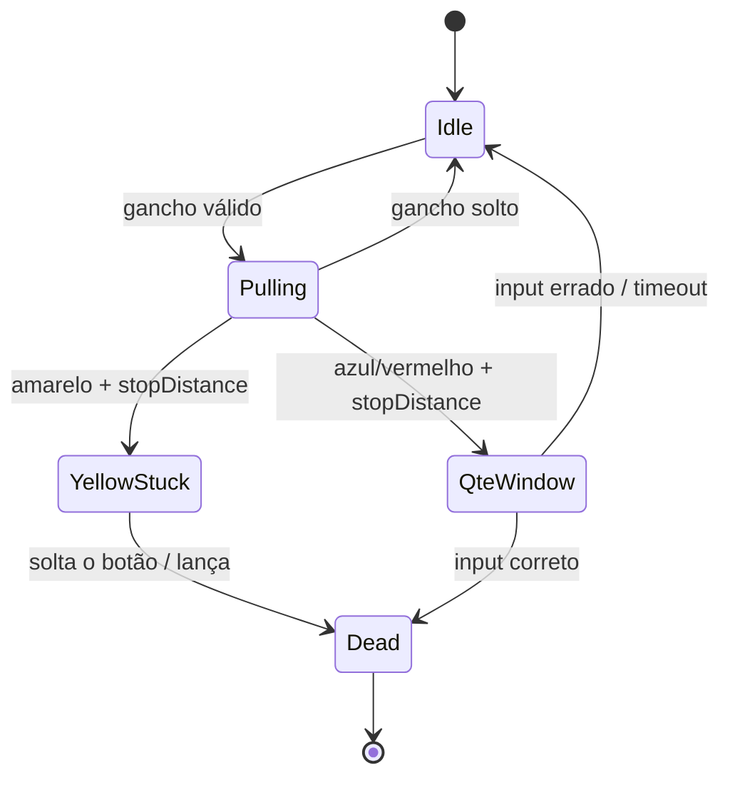

# Pindorama — Mechanics / Rules Specification

**Status:** living document  
**Versão:** 0.1  
**Última atualização:** 2026-11-19  
**Escopo:** regras jogáveis dos sistemas implementados e dos protótipos atuais.  
**Documentos relacionados:** [`README.md`](../README.md), [`LEVEL02.md`](../LEVEL02.md),
[`ENEMIES.md`](../ENEMIES.md).

> Este documento é a fonte canônica das **regras de design**. Detalhes de
> implementação (classes, eventos, ordem de execução) ficam no futuro `TDD.md`.
> Quando o código e este documento divergirem, a divergência deve ser resolvida
> e registrada no changelog.

## Legenda de status

| Tag | Significado |
|---|---|
| `[IMP]` | Implementado e jogável |
| `[PROT]` | Protótipo funcional, sujeito a ajuste |
| `[PLAN]` | Planejado, ainda não implementado |

## 1. Visão e pilares

Pindorama é um platformer 2D de precisão e momentum, inspirado em Sanabi, com
dois ganchos coloridos e movimentação baseada em física.

Pilares:

1. **Momentum:** o jogador deve encadear gancho, balanço e pulo sem parar.
2. **Precisão:** cor do gancho, mira e timing importam.
3. **Risco/recompensa:** se pendurar e mirar bem acelera; errar custa tempo/vida.
4. **Leitura visual:** cores e VFX comunicam o que é interativo e o que é letal.

## 2. Controles e verbos

| Verbo | Teclado/mouse | Gamepad |
|---|---|---|
| Mover | `A`/`D` ou setas | stick esquerdo |
| Mirar | mouse | mouse/sem mira analógica |
| Gancho vermelho | LMB | `LB` |
| Gancho azul | RMB | `RB` |
| Pular / soltar ganchos | `Espaço` | `A` |
| Swing Boost | `Shift` | `X` |
| Soltar sem pular | `Ctrl` | `B` |
| Subir/descer na parede | `W`/`S` ou `↑`/`↓` | stick vertical |
| Soltar parede | `Ctrl` | `B` |
| Reset do nível | `R` | — |
| Finalizar QTE | botão da cor / botão oposto conforme regra | `LB`/`RB` |

### Regras de input

- **R-INPUT-01 [IMP]** A mira é feita com o mouse; não há mira por stick direito.
- **R-INPUT-02 [IMP]** Os dois botões do mouse podem ser usados ao mesmo tempo.
- **R-INPUT-03 [IMP]** `R` reinicia o jogador no spawn da fase atual.
- **R-INPUT-04 [IMP]** Durante QTE/estilingue, o `DualHookController` tem o
  input suspenso; o inimigo lê os botões diretamente.

## 3. Estado global do jogador



### Regras de arbitragem

- **R-STATE-01 [IMP]** A prioridade de controle é:
  1. morte/respawn;
  2. interação com inimigo (`EnemyPull`/`EnemyStick`);
  3. Wall Cling;
  4. brace dos dois ganchos;
  5. movimento normal.
- **R-STATE-02 [IMP]** Enquanto uma interação com inimigo está ativa, o
  `PlayerController2D` não aplica movimento, gravidade ou pulo.
- **R-STATE-03 [IMP]** Enquanto está pendurado na parede, o jogador não aplica
  movimento normal nem gravidade.
- **R-STATE-04 [IMP]** O brace zera a velocidade e a gravidade; o jogador só
  volta ao normal quando um dos ganchos solta.
- **R-STATE-05 [PROT]** Não há sistema de vida: dano de laser, projétil ou
  contato com inimigo chama `LevelController.RespawnPlayer()`.

## 4. Movimento

### Valores padrão

| Parâmetro | Valor |
|---|---:|
| Velocidade de corrida | 7 |
| Aceleração no chão | 60 |
| Desaceleração no chão | 80 |
| Aceleração no ar | 30 |
| Desaceleração no ar | 10 |
| Velocidade do pulo | 16.8 |
| Grapple jump | 13 |
| Gravidade normal | 4.5 |
| Gravidade com swing | 3.4 |
| Queda máxima | 24 |
| Coyote time | 0.1 s |
| Jump buffer | 0.12 s |

### Regras

- **R-MOV-01 [IMP]** O movimento horizontal usa aceleração/desaceleração
  separadas para chão e ar.
- **R-MOV-02 [IMP]** O pulo normal aplica velocidade vertical de 16.8.
- **R-MOV-03 [IMP]** O coyote time permite pular até 0.1 s após sair do chão.
- **R-MOV-04 [IMP]** O jump buffer aceita o pulo até 0.12 s antes de encostar
  no chão.
- **R-MOV-05 [IMP]** A gravidade cai para 3.4 enquanto há um gancho de swing
  ativo.
- **R-MOV-06 [IMP]** A velocidade de queda é limitada a 24.
- **R-MOV-07 [IMP]** Se o jogador aperta pulo no ar com gancho preso, solta os
  ganchos e recebe um “grapple jump” vertical de pelo menos 13, preservando o
  momentum horizontal.
- **R-MOV-08 [IMP]** `IsGrounded` é detectado por um círculo na base do
  collider; triggers não contam como chão.

## 5. Sistema de gancho

### 5.1 Mãos e cores

| Mão | Botão | Cor |
|---|---|---|
| Esquerda | LMB | vermelho |
| Direita | RMB | azul |

- **R-HOOK-01 [IMP]** Cada mão só pode prender em âncoras da própria cor ou
  âncoras neutras.
- **R-HOOK-02 [IMP]** A mão vermelha não prende em âncora azul; a mão azul não
  prende em âncora vermelha.
- **R-HOOK-03 [IMP]** Se a primeira colisão do raio é uma âncora incompatível,
  o gancho falha; não atravessa para prender no que está atrás.
- **R-HOOK-04 [IMP]** Âncoras de cenário (paredes/teto) são neutras.
- **R-HOOK-05 [IMP]** Inimigos coloridos usam a cor do seu tipo:
  `RedQte` → vermelho, `BlueQte` → azul, `Yellow` → neutro.

### 5.2 Disparo

- **R-HOOK-06 [IMP]** O disparo é um raycast instantâneo com alcance 10.
- **R-HOOK-07 [IMP]** O cooldown entre disparos é 0.12 s.
- **R-HOOK-08 [IMP]** Um disparo sem alvo válido entra em cooldown de falha de
  0.18 s.
- **R-HOOK-09 [IMP]** O primeiro collider que não é o jogador decide o
  resultado do raio.
- **R-HOOK-10 [IMP]** O disparo só ocorre se a mão estiver livre (idle/failed).
- **R-HOOK-11 [IMP]** O primeiro clique dispara imediatamente; não há espera
  para detectar um disparo espelhado.

### 5.3 Swing

- **R-HOOK-12 [IMP]** Em âncora de swing, o jogo cria um `DistanceJoint2D`
  com `maxDistanceOnly = true`; a corda limita distância, mas permite
  aproximação.
- **R-HOOK-13 [IMP]** O comprimento inicial da corda é limitado entre 1.5 e 12.
- **R-HOOK-14 [IMP]** Ao prender, a corda recolhe até 1.5 unidades a 9 u/s e
  aplica um impulso inicial de 3.5 na direção da âncora.
- **R-HOOK-15 [IMP]** Se a distância passar de 1.2× o comprimento da corda, a
  componente de velocidade para fora é removida.
- **R-HOOK-16 [IMP]** Âncoras de swing são “segure para manter”: soltar o
  botão solta o gancho.
- **R-HOOK-17 [IMP]** Em âncora móvel (Bola Amarela), o pivô é o centro da
  âncora, não o ponto lateral do hit.

### 5.4 Disparo espelhado

- **R-DUAL-01 [IMP]** O primeiro botão dispara imediatamente.
- **R-DUAL-02 [IMP]** Se o segundo botão for pressionado em até 0.2 s, ele
  completa o par no lado oposto da mira.
- **R-DUAL-03 [IMP]** A mão que aceita a cor da âncora mirada vai na mira; a
  outra vai no lado oposto.
- **R-DUAL-04 [IMP]** Se a primeira mão não aceita a cor mirada, ela dispara
  no lado oposto; a segunda, se vier, vai na mira.
- **R-DUAL-05 [IMP]** O par espelhado exige as duas mãos livres.

### 5.5 Brace

- **R-BRACE-01 [IMP]** Com **os dois** ganchos presos, o jogador entra em
  brace: velocidade zero e gravidade zero.
- **R-BRACE-02 [IMP]** Com apenas **um** gancho preso, o jogador não congela;
  continua com movimento/gravidade normal (exceto nas interações de parede ou
  inimigo).
- **R-BRACE-03 [IMP]** O brace termina quando qualquer um dos ganchos solta.
- **R-BRACE-04 [PROT]** Existe a opção `braceOnlyWithPullable`; quando ligada,
  o brace só ocorre se pelo menos um gancho estiver em um puxável. O padrão
  atual é `false`.

### 5.6 Swing Boost

- **R-BOOST-01 [IMP]** `Shift`/X aplica impulso tangencial ao arco do pêndulo.
- **R-BOOST-02 [IMP]** O impulso é de 10 unidades na tangente, no sentido da
  velocidade atual; se a velocidade tangencial for baixa, usa o input
  horizontal como desempate.
- **R-BOOST-03 [IMP]** A velocidade resultante é limitada a 26.
- **R-BOOST-04 [IMP]** O cooldown é de 1.2 s.
- **R-BOOST-05 [IMP]** Não é permitido no chão, no brace ou durante interação
  com inimigo.
- **R-BOOST-06 [IMP]** O cooldown reinicia quando o jogador encosta no chão ou
  deixa de estar em swing.

### 5.7 Puxáveis

- **R-PULL-01 [IMP]** O gancho preso em um `HookAnchor` do tipo `Fixed` não
  cria joint e não trava o jogador.
- **R-PULL-02 [IMP]** Um clique prende; um novo comando (ou segurar) inicia o
  puxão; o puxável se move em passos.
- **R-PULL-03 [IMP]** Se o jogador se afastar além do comprimento máximo da
  corda, o cabo solta.
- **R-PULL-04 [IMP]** Caixas dinâmicas usam velocidade/gravidade e não
  `MovePosition`.

## 6. Wall Cling

### Detecção

- **R-WALL-01 [IMP]** Só paredes na layer `ClimbableWall` são escaláveis.
- **R-WALL-02 [IMP]** A detecção usa dois raycasts: peito (`+0.35`) e cintura
  (`-0.25`), com distância 0.55.
- **R-WALL-03 [IMP]** Os dois raios precisam acertar o **mesmo collider** e a
  normal precisa ser horizontal; isso evita quinas e chão.
- **R-WALL-04 [IMP]** O jogador precisa estar no ar (`!IsGrounded`).
- **R-WALL-05 [IMP]** A entrada automática ocorre se o jogador pressiona na
  direção da parede, tem velocidade horizontal para ela ou está sendo puxado
  por um gancho.
- **R-WALL-06 [IMP]** Não agarra durante brace, interação com inimigo ou
  enquanto está sendo puxado por inimigo.

### Física e movimento

- **R-WALL-07 [IMP]** Ao agarrar: velocidade zero, gravidade zero,
  `FreezePositionX`, rotação travada.
- **R-WALL-08 [IMP]** Ao agarrar: solta todos os ganchos, reseta cooldown de
  gancho e boost, e vira o visual para a parede.
- **R-WALL-09 [IMP]** `W`/`↑` sobe a 2 u/s.
- **R-WALL-10 [IMP]** `S`/`↓` desce a 3.2 u/s; se encostar no chão, solta.
- **R-WALL-11 [IMP]** Sem input vertical, fica parado.
- **R-WALL-12 [IMP]** `Espaço`/A executa wall jump: impulso de 12 na normal
  (para longe da parede) e 15 para cima, restaurando a gravidade.
- **R-WALL-13 [IMP]** `Ctrl`/B solta a parede sem pular.
- **R-WALL-14 [IMP]** Após pular, soltar ou sair, há re-grab cooldown de 0.2 s.
- **R-WALL-15 [IMP]** Disparar um gancho enquanto pendurado solta a parede
  assim que o gancho prende e deixa o joint puxar.
- **R-WALL-16 [IMP]** Se a parede desaparece ou o trecho escalável termina, o
  jogador solta.
- **R-WALL-17 [IMP]** `S`/`↓` **não** solta mais a parede; para soltar use
  `Ctrl`/B.

### Paredes parciais

- **R-WALL-18 [IMP]** A `ParedeDireita` da Level02 tem um trecho escalável
  (teal, embaixo) e um trecho comum (cinza, em cima).
- **R-WALL-19 [IMP]** Só o trecho na layer `ClimbableWall` e com `HookAnchor`
  permite subir/descer e prender o gancho.

## 7. Caixas, puzzles e objetos

### 7.1 Caixas dinâmicas

- **R-BOX-01 [IMP]** Caixas de puzzle usam `Rigidbody2D` dinâmico com
  `FreezeRotation`.
- **R-BOX-02 [IMP]** O puxão aplica velocidade horizontal com aceleração 45,
  velocidade 5 e overshoot 0.4 além do jogador.
- **R-BOX-03 [IMP]** A caixa respeita gravidade, chão e paredes; não atravessa
  o cenário.
- **R-BOX-04 [IMP]** Ao encaixar, a caixa centraliza no snap point em 0.18 s,
  vira kinematic, desliga colliders e solta ganchos presos nela.

### 7.2 Encaixe e no-tilt

- **R-SNAP-01 [IMP]** Cada marcação aceita apenas a cor configurada.
- **R-SNAP-02 [IMP]** A caixa é centralizada no `SnapPoint` e tem a rotação
  travada; não tomba.
- **R-SNAP-03 [IMP]** Caixa da cor errada na marcação dispara falha imediata.
- **R-SNAP-04 [IMP]** Caixa encaixada não pode ser puxada novamente até reset.

### 7.3 Puzzle de sincronização

- **R-PUZZLE-01 [IMP]** Todas as marcações precisam estar ocupadas ao mesmo
  tempo para resolver.
- **R-PUZZLE-02 [IMP]** Se pelo menos uma marcação estiver ocupada e o
  conjunto não estiver completo por mais de 3 s, o puzzle falha.
- **R-PUZZLE-03 [IMP]** Caixa errada em qualquer marcação falha imediatamente.
- **R-PUZZLE-04 [IMP]** Na falha: explosão visual, todas as caixas voltam aos
  spawns, cooldown de 0.75 s.
- **R-PUZZLE-05 [IMP]** No sucesso: os lasers configurados são desligados
  permanentemente.
- **R-PUZZLE-06 [IMP]** O puzzle resolvido não volta a falhar até reset da
  fase.

### 7.4 Laser

- **R-LASER-01 [IMP]** `Laser 1` começa ativo.
- **R-LASER-02 [IMP]** Contato com o feixe chama respawn imediato.
- **R-LASER-03 [IMP]** O laser desligado pelo puzzle não religa durante a fase.

### 7.5 Bola Amarela

- **R-BALL-01 [IMP]** A bola se move verticalmente em vaivém, em velocidade
  fixa (padrão 2).
- **R-BALL-02 [IMP]** O gancho prende no centro da bola; o pivô físico é o
  centro.
- **R-BALL-03 [IMP]** O jogador é carregado pelo movimento da bola via joint;
  não é parenteado nem tem a física desligada.
- **R-BALL-04 [IMP]** A bola é kinematic e mantém a rotação travada.
- **R-BALL-05 [IMP]** O jogador continua colidindo com o chão enquanto está
  pendurado na bola.

## 8. Inimigos

### 8.1 Tipos e corpos

| Dimensão | Valores |
|---|---|
| `EnemyType` | `Yellow`, `BlueQte`, `RedQte` |
| `EnemyArchetype` | `Soldier`, `Turret` |

- **R-ENEMY-01 [IMP]** O tipo define a interação com o gancho; o arquétipo
  define o corpo/comportamento.
- **R-ENEMY-02 [IMP]** Uma torreta pode ser de qualquer um dos 3 tipos; um
  soldado também.
- **R-ENEMY-03 [IMP]** `RedQte` só aceita gancho vermelho; `BlueQte` só azul;
  `Yellow` é neutro.
- **R-ENEMY-04 [IMP]** O gancho da cor errada não prende e não puxa o jogador.
- **R-ENEMY-05 [IMP]** O inimigo não tem barra de vida; a interação correta
  mata instantaneamente.

### 8.2 Estados



- **R-ENEMY-06 [IMP]** O puxão usa velocidade 9, aceleração 35 e para a 1.4
  unidades do inimigo.
- **R-ENEMY-07 [IMP]** Durante o puxão, o jogador fica sem gravidade e o
  inimigo controla a velocidade; o input de gancho ainda pode soltar.
- **R-ENEMY-08 [IMP]** Ao chegar, o jogador é congelado (posição/velocidade) e
  o input de gancho é suspenso.
- **R-ENEMY-09 [IMP]** Morte do inimigo: VFX, collider/sprite desligados e
  objeto destruído em 0.2 s.

### 8.3 Amarelo — estilingue

- **R-YELLOW-01 [IMP]** Ao grudar, `Time.timeScale` vai para 0.25.
- **R-YELLOW-02 [IMP]** O jogador fica parado, mira com o mouse e mantém o
  botão do gancho pressionado.
- **R-YELLOW-03 [IMP]** Ao soltar o botão, o jogador é lançado na direção da
  mira com velocidade 20.
- **R-YELLOW-04 [IMP]** O inimigo é destruído e o collider dele é desligado
  para o jogador atravessar.
- **R-YELLOW-05 [IMP]** `Time.timeScale` volta a 1 no lançamento, cancelamento,
  morte ou disable.
- **R-YELLOW-06 [IMP]** O amarelo não usa janela de tempo; pode segurar
  indefinidamente.

### 8.4 QTE azul/vermelho

- **R-QTE-01 [IMP]** A janela é de 1 s, usando tempo não escalado.
- **R-QTE-02 [IMP]** `RedQte` só é acessível com gancho vermelho; `BlueQte`
  só com azul.
- **R-QTE-03 [IMP]** Com o gancho da cor do inimigo preso:
  - Red: aceita **LMB down**, **RMB down** ou **LMB up**;
  - Blue: aceita **RMB down**, **LMB down** ou **RMB up**.
- **R-QTE-04 [IMP]** Acerto: inimigo destruído e jogador liberado.
- **R-QTE-05 [IMP]** Erro ou timeout: jogador é rebatido com força 12, o
  inimigo permanece vivo e há cooldown de 0.7 s antes de novo gancho.
- **R-QTE-06 [PROT]** A regra é intencionalmente generosa porque o botão da
  cor já está pressionado quando o gancho prende.

### 8.5 Soldado

- **R-SOLDIER-01 [IMP]** Patrulha horizontal de até 2 unidades a 1.2 u/s.
- **R-SOLDIER-02 [IMP]** Para de patrulhar durante qualquer interação com
  gancho.
- **R-SOLDIER-03 [IMP]** Contato com o jogador chama respawn.

### 8.6 Torreta

- **R-TURRET-01 [IMP]** Rajada de 3 projéteis com intervalo de 0.15 s.
- **R-TURRET-02 [IMP]** Cooldown de 1.4 s após a rajada.
- **R-TURRET-03 [IMP]** Projétil viaja a 9 u/s e chama respawn ao acertar o
  jogador.
- **R-TURRET-04 [IMP]** A torreta pausa o tiro enquanto está em interação com
  o gancho.
- **R-TURRET-05 [IMP]** A torreta pode ser de qualquer um dos 3 tipos.

## 9. Níveis e fluxo

- **R-LEVEL-01 [IMP]** `Main` é uma sala de testes gerada em runtime pelo
  `GameBootstrap`.
- **R-LEVEL-02 [IMP]** `Level02` é uma cena autoral com plataformas, âncoras,
  caixas, pits, laser, espinhos e Bola Amarela.
- **R-LEVEL-03 [IMP]** `EnemyLab` é a cena de validação de inimigos, com 3
  soldados + 3 torretas.
- **R-LEVEL-04 [IMP]** O spawn/respawn do jogador é controlado pelo
  `LevelController`.
- **R-LEVEL-05 [IMP]** `R` respawna o jogador; na `Level02` também reseta o
  puzzle.
- **R-LEVEL-06 [PROT]** `R` no `EnemyLab` não revive inimigos mortos; reinicie
  o Play Mode para restaurar a cena inteira.

## 10. Feedback e UX

- **R-UX-01 [IMP]** Ganchos têm corda neon e VFX de impacto.
- **R-UX-02 [IMP]** O HUD mostra estado dos ganchos, boost e prompts de QTE.
- **R-UX-03 [IMP]** A mira mostra linha pontilhada e retículo.
- **R-UX-04 [IMP]** O boost tem flash de corda, trail e speed lines.
- **R-UX-05 [IMP]** Cores comunicam interação: paredes escaláveis em teal,
  inimigos vermelhos/azuis/amarelos.
- **R-UX-06 [PLAN]** Assistência de mira suave para ganchos.

## 11. Invariantes e casos de borda

- **R-EDGE-01** Um gancho nunca prende em duas âncoras ao mesmo tempo.
- **R-EDGE-02** Um jogador não pode estar em Wall Cling e interação de inimigo
  ao mesmo tempo.
- **R-EDGE-03** Um jogador não pode estar em brace e Wall Cling ao mesmo tempo.
- **R-EDGE-04** `Time.timeScale` do amarelo sempre volta a 1 ao sair do estado.
- **R-EDGE-05** Caixa encaixada não mantém gancho preso nela.
- **R-EDGE-06** Laser desligado não pode ser reativado durante a fase.
- **R-EDGE-07** A Bola Amarela nunca deve ser parenteada ao jogador.

## 12. Valores de balanceamento (defaults)

> Valores de Inspector; cenas e prefabs podem sobrescrever.

| Sistema | Campo | Default |
|---|---|---:|
| Gancho | range | 10 |
| Gancho | cooldown | 0.12 |
| Gancho | failCooldown | 0.18 |
| Gancho | dualChordWindow | 0.2 |
| Gancho | minRopeLength | 1.5 |
| Gancho | maxRopeLength | 12 |
| Gancho | swingAcceleration | 30 |
| Gancho | maxGrappleSpeed | 26 |
| Gancho | attachReelDistance | 1.5 |
| Gancho | attachReelSpeed | 9 |
| Gancho | attachImpulse | 3.5 |
| Gancho | maxStretch | 1.2 |
| Boost | impulse | 10 |
| Boost | cooldown | 1.2 |
| Wall | wallCheckDistance | 0.55 |
| Wall | regrabCooldown | 0.2 |
| Wall | climbUpSpeed | 2 |
| Wall | climbDownSpeed | 3.2 |
| Wall | wallJumpForceX/Y | 12 / 15 |
| Caixa | dynamicPullSpeed | 5 |
| Caixa | dynamicPullAcceleration | 45 |
| Caixa | dynamicPullOvershoot | 0.4 |
| Puzzle | simultaneousWindow | 3 |
| Puzzle | failureCooldown | 0.75 |
| Bola | speed | 2 |
| Inimigo | pullSpeed | 9 |
| Inimigo | pullAcceleration | 35 |
| Inimigo | stopDistance | 1.4 |
| Amarelo | slowScale | 0.25 |
| Amarelo | launchSpeed | 20 |
| QTE | window | 1 |
| QTE | knockback | 12 |
| Torreta | burstCount | 3 |
| Torreta | burstInterval | 0.15 |
| Torreta | cooldown | 1.4 |
| Torreta | projectileSpeed | 9 |
| Soldado | patrolRange | 2 |
| Soldado | speed | 1.2 |

## 13. Critérios de aceite

### Gancho e cor

```text
Dado que o jogador mira em uma torreta vermelha
Quando dispara a mão azul
Então o gancho não prende, não cria joint e não puxa o jogador.
```

```text
Dado que o jogador mira na mesma torreta vermelha
Quando dispara a mão vermelha
Então o gancho prende, o puxão começa e o jogador é levado até a torreta.
```

### Parede

```text
Dado que o jogador está no ar e encostado em uma parede ClimbableWall
Quando pressiona na direção da parede
Então entra em Wall Cling, zera velocidade/gravidade e pode subir com W.
```

```text
Dado que o jogador está pendurado na parede
Quando aperta Espaço
Então recebe impulso para longe da parede e não re-gruda por 0.2 s.
```

### Caixas

```text
Dado que uma caixa vermelha entra na marcação azul
Quando o trigger é processado
Então o puzzle falha, as caixas explodem e voltam aos spawns.
```

```text
Dado que as duas caixas corretas estão nas duas marcações ao mesmo tempo
Quando o puzzle valida
Então o laser é desligado permanentemente.
```

### Inimigos

```text
Dado que o jogador prendeu o gancho vermelho em um RedQte e está grudado
Quando aperta RMB ou solta LMB
Então o inimigo é destruído.
```

```text
Dado que o jogador prendeu o gancho vermelho em um RedQte
Quando deixa a janela de 1 s passar sem input
Então é rebatido e o inimigo permanece vivo.
```

## 14. Perguntas em aberto e gaps

| Item | Status | Observação |
|---|---|---|
| Assistência de mira | `[PLAN]` | Ainda é hitscan puro |
| Vida/dano | `[PLAN]` | Hoje dano = respawn |
| Reset completo do EnemyLab | `[PLAN]` | `R` não revive inimigos |
| Animações de inimigo | `[PLAN]` | Sprites geométricos |
| Áudio | `[PLAN]` | Sem SFX/música |
| Checkpoints | `[PLAN]` | Só spawn da fase |
| Tipos de tiro de torreta | `[PLAN]` | Só projétil reto |
| Patrulha com detecção de borda | `[PLAN]` | Range fixo |

## 15. Changelog

| Versão | Data | Mudança |
|---|---|---|
| 0.1 | 2026-11-19 | Documento inicial: movimento, gancho, parede, caixas, laser, bola e inimigos. |
